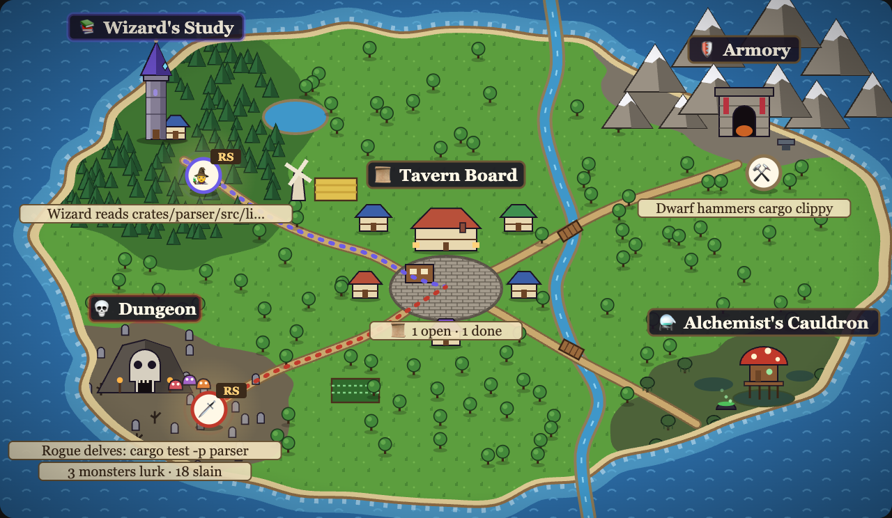
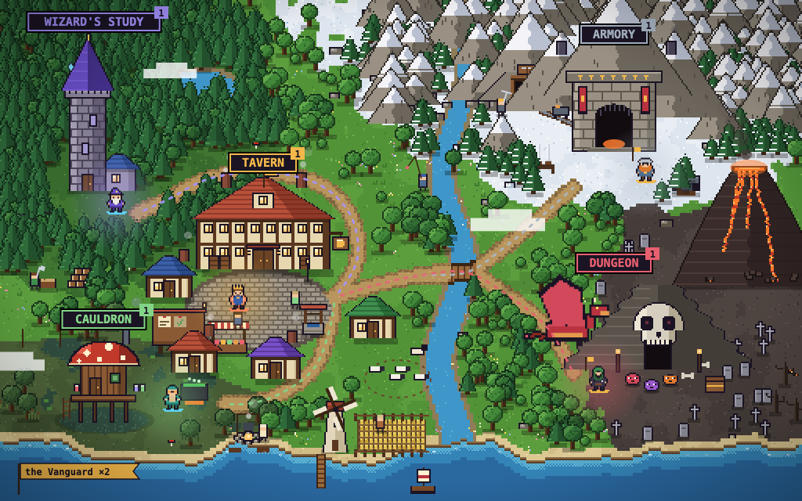

# 🏰 Guild Code

**A medieval guild hall for Claude Code.** As Claude works, a live world map shows your party travelling an island realm between five places: the Tavern Board in the guild town, the Wizard's Study in its forest tower, the Dungeon in the badlands, the Armory in the mountains and the Alchemist's Cauldron in the swamp. Failing tests become monsters, edits are forged in the Armory, and builds bubble in the Cauldron.



It is a **mod** for Claude Code: it runs inside Claude's own engine, draws a pane beside the conversation, and watches the real work through hooks. Nothing about how Claude works changes, and if Guild Code ever errors, the work carries on without it.

## Install

You need **Claude Code 2.1.295 or later** (the mod uses the engine's mod API) and **`python3`** on your `PATH` for the full Guild Hall page.

### From GitHub

At the prompt of a Claude Code session:

```
/plugin install guild-code --marketplace Dinesh94Singh/Guild-Code
```

Answer `y` to add the marketplace, then pick a scope: **user** loads it in every session, **project** only in this repository. Or, from your shell:

```bash
claude plugin marketplace add Dinesh94Singh/Guild-Code
claude plugin install guild-code@guild-code
```

Start a new session and run `/guild`. To pick up a newer version later, run `claude plugin marketplace update guild-code`; to switch it off, `claude plugin disable guild-code`.

### From a clone (to try a branch, or to hack on it)

```bash
git clone https://github.com/Dinesh94Singh/Guild-Code.git
claude --plugin-dir ./Guild-Code
```

The session loads the mod straight from the folder and reloads it when you save a file. To load it in every session you start from your shell, set `CLAUDE_CODE_PLUGIN_DIRS=/path/to/Guild-Code` instead.

### Just look

No install needed for the **dry run**: clone the repository and open [`demo/guild-hall.html`](demo/guild-hall.html) in a browser. Five sample projects (Rust, Python, JS/TS, Java, C++) replay through the mod's real classifier on the same island; you can pause, speed up, follow a project, and cast your own shell command to see which place it lands in.

## Take the tour

1. **Start a session** in any project with the mod loaded, and **run `/guild`**. The Guild Hall opens at `http://guildmaster.localhost:8790/`: in the desktop app's browser pane, or in your browser where there is none. It shows every session on this machine on one island, each project in its own colour, and updates every couple of seconds. The Guildmaster (your session) rests at the Tavern. Sessions that have ended, or sat unused for an hour, sleep at the Tavern (💤), up to five sessions in all; an ended one is forgotten a day after it was last used. The chronicle keeps the last three hours of deeds.
2. **Give Claude some work** that crosses the realm, for example:
   > Read the README, run the tests, fix what fails, then run the linter.

   The Guildmaster walks to the Wizard's Study while it reads, delves into the Dungeon for the tests (each failing test is a slime; the slimes fall as tests pass), and forges at the Armory while it edits and lints. Ask it to *use subagents* and each one joins the party at the Tavern door and walks to its own place.
3. **Want the map beside the chat instead?** `/guild-map` opens it as a pane in Claude (in the terminal, as five rooms in text):

   

4. **On the Guild Hall page**, try:
   - **`−` / `+`** (or the mouse wheel) to zoom from the whole island down to a single place and back.
   - **SETTINGS** for the legend, follow or world-map camera, weather, time of day, and a place to visit.
   - **Click a place or a hero** to see who is there, what they are doing and their latest deeds.
   - **The Guildmaster's Desk**: write a quest, pick who to summon, and press **Draft petition**. It lands in that session's prompt box for you to send. Switch to **Sealed** to send it at once. **Decrees** are one-press prompts for what the guild can see right now: slay the monsters, re-run the trial, pursue or verify a quest, ration mana, recall a subagent, ask the scribe.
5. **Open a second session** in another project. Its party appears on the same island in a new colour, and the desk can send quests to either.

## The hall

| Room | What happens there |
| --- | --- |
| 📜 **Tavern Board** | Your prompts arrive as quests. Subagents are dispatched and return. The task list is the quest board. |
| 📚 **Wizard's Study** | Reading files, searching, docs and the web: `Read`, `Grep`, `Glob`, `WebFetch`, `git log`, `ls`, … |
| 💀 **Dungeon** | Test runs. Failing tests are monsters; the pane counts what lurks and what you slew. |
| 🛡️ **Armory** | Edits and writes, linters, formatters, type checkers and diffs. |
| ⚗️ **Alchemist's Cauldron** | Builds, installs, bundlers, compilers and containers. |

When a compound command touches several rooms (`cargo build && cargo test`), it goes to the most dangerous one.

### The party

The **Guildmaster** (crowned, caped in its project's colour) is the session itself, the main loop you talk to. While it works it takes up the class of the place it is in, so the Guildmaster reading files looks like a Wizard; the sidebar still lists it as the main loop.

Every **subagent** Claude dispatches joins the party at the Tavern door as its own member, walks to its place, and returns when its work is done. Summoning a class from the desk asks the session to send that subagent. Guild Code ships four class subagents; any other subagent type takes the class of the place it works in:

| Class | Agent type | Specialty |
| --- | --- | --- |
| 🧙 Wizard | `guild-code:wizard` | Read-only research: maps the toolchain, relevant files and conventions |
| 🗡️ Rogue | `guild-code:rogue` | Hunts failing tests and bugs; isolates, fixes the root cause, re-runs |
| ⚒️ Dwarf | `guild-code:dwarf` | Formatting, linting, type-checking and clean diffs |
| 🧪 Alchemist | `guild-code:alchemist` | Dependencies, builds, bundles and Docker; diagnoses build failures |

Classes earn XP for work done (more for slaying monsters), and XP persists across sessions. `/guild-stats` shows the record.

When two or more subagents are out at once they march as a **team** (the Vanguard, the Lantern Company, …): each member wears the team's colour on the map and the team flies its banner until everyone is back.

### Guild Crowns and the merchant

Good work earns **Guild Crowns**, and crowns buy things for the island. XP still levels each class; crowns are the purse you spend.

| Deed | Crowns |
| --- | --- |
| A monster slain (a failing test now passes) | 10 each |
| The dungeon cleared (the suite goes green after a failure) | 40 |
| A clean brew (a build, install or bundle succeeds) | 8 |
| A spoiled brew rescued (a failed build now passes) | 20 |
| A blade tempered (a linter, formatter or type checker comes back clean) | 6 |
| A commit scribed | 5 |
| A quest closed (a task on the board is done) | 15 |
| A party returned (a subagent comes home) | 5 |
| A team marched (two or more subagents at once) | 20 |

Crowns pay for results, never for raw tool calls or tokens, and an hour pays at most 300, so a loop can't farm them. The first quest closed each day pays a **streak** bonus that grows from 10 to 60 over a week; a missed day steps the streak back one day rather than to the start.

Press **SHOP** on the Guild Hall page (or **VISIT THE MERCHANT** on the Treasury card) to spend them. Each ware has its own patch of the island and comes alive with the work: the bell tower rings when a dungeon is cleared, the bard plays when a quest closes, the obelisk's runes burn while the Study reads, the potion shelf glows while a brew bubbles, the lighthouse sweeps the sea at night, and the guild hound trots after the Guildmaster. Sell a ware back for half its price.

Your **rank** (Hamlet, Village, Town, Port, City, Kingdom) follows every crown ever earned, so spending never sets you back; each rank opens a finer tier of wares. The purse is one per machine, kept in the mod's store beside the XP, since every project shares the one island. Wares show on the Guild Hall page; the map pane draws the island as it was.

### Seasons

Theme packs dress the island for the time of year, by your calendar: Hallow's Eve (15 Oct – 1 Nov), the Harvest Feast (10 – 30 Nov) and Midwinter (1 Dec – 6 Jan). Each changes the light, the folk, the monsters and the sky, runs one small event that fills as you close quests, and brings wares the merchant sells only in season (what you buy stays built). SETTINGS → SEASON shows any pack by hand, or none.

### The pane and the Guild Hall page

- **The map pane** (`/guild-map`) is the live map and nothing else: every session on this machine on one island, each party tagged in its project's colour, and, once `/guild` has run, a link to the full hall.
- **The Guild Hall page** (`/guild`) is the place to act, at `http://guildmaster.localhost:8790/` (browsers send every `*.localhost` name to your own machine; `http://127.0.0.1:8790/` works too, and the port moves up if 8790 is taken). It is served from your session on `127.0.0.1` only, by a small `python3` server (`hooks/hall-server.py`), and reads a `live.json` that the session keeps fresh under `~/.claude/guild-code/hall/<session id>/`. The page carries a token minted by that server, so no other site can post quests to your sessions.
- **One screen.** The map fills the window's height, the sidebar scrolls beside it, and the whole island is in view, sized to the window.
- **Mana.** The sidebar's Model Quota card shows the account's rate-limit windows (5-hour, weekly) with what is left and when each resets. A session billed by API key has no such windows; the page uses the freshest reading any open session has.
- **Waiting on you.** Only a decision raises the call: an agent asking permission for a tool, asking you a question, or showing a form raises a red `!` on the map and a card at the top of the sidebar, and the session sends a notification. Answer it in Claude. A session that is merely idle rests at the Tavern with a sleeping `z`; it never nags you for a quest.
- **Night and weather.** After dark (by your local clock) the realm dims and its windows, torches and forge light up; the weather turns on its own, or set it in SETTINGS. At night and in rain, storm or snow the realm takes shelter: townsfolk go indoors, workers and travellers head home, the flock huddles in its pen, the deer slip into the woods, birds vanish, and the dragon sinks into the fire mountain, bursting out again when it clears. Your party works on through it all.

## Supported toolchains (V1)

| Language | 💀 Dungeon (tests) | 🛡️ Armory (lint, format, diff) | ⚗️ Cauldron (build) |
| --- | --- | --- | --- |
| **JavaScript / TypeScript** | jest, vitest, mocha, ava, tap, jasmine, karma, playwright, cypress, wdio, `node --test`, `bun test`, `npm/pnpm/yarn test` | eslint, prettier, biome, oxlint, stylelint, standard, xo, `tsc --noEmit`, deno lint/fmt, `npm run lint` | npm/pnpm/yarn/bun install & build, vite, webpack, rollup, esbuild, parcel, next, nuxt, turbo, nx, tsup, swc, babel |
| **Python** | pytest, unittest, nose2, tox, nox, coverage, `manage.py test`, behave | ruff, black, isort, flake8, pylint, mypy, pyright, autopep8, yapf, bandit | pip, uv, poetry, pdm, hatch, conda, pipenv, maturin, `python -m build`, setup.py |
| **Java** | `mvn test/verify`, `-Dtest=`, `gradle test/check`, JUnit console | spotless, checkstyle, PMD, SpotBugs, google-java-format | mvn package/install, gradle build/assemble, javac, java -jar, ant |
| **C++** | ctest, GoogleTest & Catch2 binaries, `meson test`, `bazel test`, `make test` | clang-format, clang-tidy, cppcheck, cpplint, include-what-you-use | cmake, make, ninja, meson, bazel, conan, vcpkg, g++/gcc/clang++ |
| **Rust** | `cargo test`, nextest, `cargo bench`, miri | `cargo fmt`, `cargo clippy`, `cargo check`, rustfmt | `cargo build/run/install`, rustc, wasm-pack, cross |
| **All** | | `git diff/commit/…`, pre-commit | docker, podman, docker compose, buildx, kubectl, helm |

Monster counts are read from the summary lines of: cargo test, cargo nextest, Maven Surefire, Gradle, CTest, GoogleTest, Catch2, pytest, unittest, Jest, Vitest, Mocha and the Node/TAP test runner.

Wrappers are seen through: `npx`, `pnpm exec`, `uv run`, `poetry run`, `env FOO=1`, `sudo`, `time`, `cd dir &&` and friends.

## Commands

- `/guild` opens the Guild Hall page in the browser.
- `/guild-map` opens the map as a pane beside the conversation.
- `/guild-stats` shows XP per class, the dungeon record and the treasury.

## Surfaces

`/guild` opens the same Guild Hall page from any surface. The map pane (`/guild-map`) is the illustrated, animated map in the desktop app, VS Code and mobile, and five bordered rooms in text, with the chronicle of recent deeds, in the terminal.

## Project layout

```
.claude-plugin/
  plugin.json         the mod's manifest
  marketplace.json    makes this repository installable with /plugin install
hooks/
  hooks.json          names the hooks module
  register.tsx        the hooks: tool calls, prompts, subagents, the pane
  classify.ts         where each command goes, and test-report parsing (pure)
  lore.ts             rooms, classes, languages
  treasury.ts         Guild Crowns: what deeds pay, ranks, and the merchant's wares (pure)
  map.ts              the SVG map the pane draws
  world.js, pixelart.js  the island, its pixel art and where each ware stands, shared with the page
  hall-server.py      serves the Guild Hall page on 127.0.0.1 and relays its quests and shop orders
agents/               the four class subagents
demo/
  src.html            the Guild Hall page: the dry run, and live when /guild serves it
  build.mjs           builds guild-hall.html from it
docs/                 screenshots
types/index.d.ts      the mod's state contract
tests/                classifier and behaviour tests
```

## Development

```
claude plugin validate .   # what the engine sees, and anything it would refuse
claude plugin test .       # runs tests/*.test.ts against the engine
node demo/build.mjs        # rebuilds demo/guild-hall.html after editing demo/src.html
```

See [CONTRIBUTING.md](CONTRIBUTING.md) to add a toolchain or a test-report format.

## License

MIT
